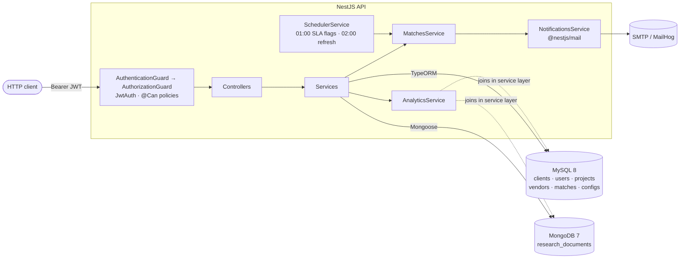

# Expanders360 – Global Expansion Management API

Backend for **Expanders360**, a platform that helps founders run expansion projects in new countries. It combines **structured data in MySQL** (clients, vendors, projects, matches) with **unstructured research documents in MongoDB**, matches projects to vendors with a scoring formula, and exposes analytics that join both databases in the service layer.

- [Tech stack](#tech-stack) · [Architecture](#architecture) · [Specification](#specification) · [API reference](#api-reference)
- [Configuration](#configuration) · [Getting started](#getting-started) · [Testing](#testing) · [Design decisions](#design-decisions) · [Limitations](#limitations--production-notes)

---

## Tech stack

| Layer | Technology | Version | Why it is used |
|---|---|---|---|
| Framework | **NestJS** (`@nestjs/common`, `core`, `platform-express`) | 12.x | Modular architecture, DI, guards, pipes |
| Language / runtime | **TypeScript**, **Node.js** | 5.9 / ≥ 20.19 (Docker: 22) | v12 packages are ESM-only, so the project is ESM (`nodenext`) |
| Relational DB | **MySQL 8.0** via **TypeORM** (`@nestjs/typeorm`, `mysql2`) | typeorm 0.3 | Clients, users, projects, vendors, matches, system configs |
| Document DB | **MongoDB 7** via **Mongoose** (`@nestjs/mongoose`) | mongoose 8 | Schema-free research documents |
| Authentication | **`@nestjs/authentication`** | 0.0.1 | JWT bearer auth (`JwtBearerProvider`, `JwtSigner`) and scrypt password hashing (`PasswordHasher`) |
| Authorization | **`@nestjs/authorization`** | 0.0.1 | Policy classes (`@Policy`, `@Can`, `AuthorizationService`) |
| Email | **`@nestjs/mail`** | 0.0.1 | `Mailable` classes, escaping `html` tag, SMTP / file / log transports |
| Scheduling | **`@nestjs/schedule`** | 12.x | Daily cron jobs |
| Configuration | **`@nestjs/config`** | 12.x | `.env` loading |
| Validation | `class-validator`, `class-transformer` | 0.15 / 0.5 | DTO validation, whitelisting, input normalization |
| API docs | **Scalar** (`@scalar/nestjs-api-reference`) + **Swagger UI** (`@nestjs/swagger`) | 1.2 / 12.x | OpenAPI at `/reference` (preferred) and `/docs` |
| Testing | **Vitest** + `unplugin-swc` + `supertest` + `@nestjs/testing` | vitest 5.x | Fast tests; SWC emits decorator metadata that Nest DI needs |
| Containers | **Docker**, **docker-compose** | – | API + MySQL + MongoDB + MailHog |

> `@nestjs/authentication`, `@nestjs/authorization` and `@nestjs/mail` are currently `0.0.1` releases. Pin exact versions and review them before production use.

---

## Architecture



**Request pipeline.** `AuthenticationModule` registers a global guard that verifies the JWT and loads the user from MySQL into `request.user`. `AuthorizationModule` registers a second global guard that enforces `@Can(...)`. Authentication **must be imported before** authorization in `AppModule`. Every route requires a token unless marked `@Public()`.

### Project structure

```
src/
├── main.ts                    bootstrap: ValidationPipe, Swagger UI (/docs), Scalar (/reference)
├── app.module.ts              wiring: TypeORM, Mongoose, Authentication → Authorization, Mail, Schedule
├── auth/                      register/login, JwtAuth (bearer provider), JWT options
├── policies/admin.policy.ts   AdminPolicy – admin-only routes
├── projects/                  entity, DTOs, service, controller, ProjectPolicy
├── vendors/                   entity, DTOs, service (incl. SLA sync), admin controller
├── matches/                   entity, MatchesService (scoring + idempotent upsert), controller
├── research/                  Mongoose schema, DTOs, service (search), controller
├── analytics/                 cross-DB top-vendors query
├── notifications/             NewMatchMail (Mailable), mail transport factory, NotificationsService
├── scheduler/                 cron jobs + admin trigger endpoints
├── settings/                  system configs (key/value) + admin endpoints
├── users/ clients/            entities
├── common/                    AuthUser, Role, normalization transformers
└── seed/seed.ts               idempotent demo-data seeder
test/                          HTTP-level (supertest) and DI-wiring tests
```

---

## Specification

### 1. Authentication & roles

| Role | Capabilities |
|---|---|
| `client` | Register themselves; create, read, update and delete **their own** projects; rebuild/list matches and upload/search research documents **for their own projects** |
| `admin` | Everything a client can do on **any** project, plus manage vendors, system configs, scheduler jobs and analytics |

- `POST /auth/register` creates a **client company and its user** in one transaction. Admins cannot self-register; one is **seeded from `ADMIN_EMAIL` / `ADMIN_PASSWORD`** on first boot if no admin exists.
- Passwords are hashed with **scrypt** (`PasswordHasher`). Hashes are self-describing and are upgraded transparently at login when parameters change. An unknown email costs the same as a wrong password (no account enumeration by timing).
- Access tokens are **HS256 JWTs** signed with `JWT_SECRET` (≥ 32 bytes), issuer `expanders360-api`, audience `expanders360-clients`, TTL `JWT_EXPIRES_IN` (default `1h`). They carry only `sub`. **Role and `clientId` are loaded from MySQL on every request**, so a token cannot claim a role and a deleted user's token stops working immediately.
- Another client's project returns **404** (not 403), so ids cannot be probed.

### 2. Relational schema (MySQL)

| Table | Columns |
|---|---|
| `clients` | `id` PK · `company_name` · `contact_email` |
| `users` | `id` PK · `email` unique · `password_hash` · `role` (`client`\|`admin`) · `client_id` FK → clients (nullable for admins) |
| `projects` | `id` PK · `client_id` FK · `country` · `services_needed` JSON `string[]` · `budget` decimal(14,2) · `status` (`draft`\|`active`\|`completed`\|`cancelled`) |
| `vendors` | `id` PK · `name` · `countries_supported` JSON `string[]` · `services_offered` JSON `string[]` · `rating` decimal(3,2) · `response_sla_hours` int · `sla_expires_at` datetime? · `sla_expired` bool |
| `matches` | `id` PK · `project_id` FK · `vendor_id` FK · `score` decimal(6,2) · `created_at` · `updated_at` · **unique (`project_id`, `vendor_id`)** |
| `system_configs` | `config_key` PK · `value` |

`sla_expires_at` / `sla_expired` extend the requested vendor schema so SLA expiry can be flagged. Deleting a project or vendor cascades to its matches. Input is normalized: countries upper-case, services and tags lower-case, lists de-duplicated.

### 3. Research documents (MongoDB)

Collection `research_documents` (schema-free `metadata` field):

```jsonc
{ "projectId": 4, "title": "Germany market report", "content": "…",
  "tags": ["market", "regulation"], "uploadedBy": 2,
  "metadata": { "any": "shape" }, "createdAt": "…", "updatedAt": "…" }
```

Indexes: `projectId`, `tags`, and a **text index on `title` + `content`**. Uploading verifies the caller may access the linked project. Search filters by `projectId`, `tag`, and full-text `q` (ranked by text score), paginated. Clients searching without `projectId` are automatically scoped to their own projects.

### 4. Project–vendor matching

`POST /projects/:id/matches/rebuild`

1. **Eligibility (MySQL query):** the vendor supports the project's country (`JSON_CONTAINS`), offers **at least one** needed service (`JSON_OVERLAPS`), and is not SLA-expired.
2. **Score:** `services_overlap × 2 + rating + SLA_weight`

   | `response_sla_hours` | ≤ 12 | ≤ 24 | ≤ 48 | > 48 |
   |---|---|---|---|---|
   | `SLA_weight` | 3 | 2 | 1 | 0 |

   Example: needs `legal, hr`; vendor offers `legal, hr, logistics`, rating 4.5, SLA 12h → `2×2 + 4.5 + 3 = 11.5`.
3. **Idempotent upsert:** `INSERT … ON DUPLICATE KEY UPDATE` on `(project_id, vendor_id)`. Re-running yields identical rows. Vendors that no longer qualify are **removed**.
4. **Notification:** an email is sent **only for newly created pairs**, so reruns never spam the client. Delivery errors are logged, never thrown.

The response lists `total`, `created`, `removed`, and the matches (best first) with `servicesOverlap` and `score`.

### 5. Analytics (cross-database)

`GET /analytics/top-vendors?days=30` (admin) returns, per country:

- the **top 3 vendors** by average match score within the window (MySQL window function `ROW_NUMBER() OVER (PARTITION BY country …)`, using `matches.updated_at`), and
- the **count of research documents** linked to projects in that country (MongoDB `$group` by `projectId`, rolled up per country **in the service layer**).

```jsonc
{ "windowDays": 30, "countries": [
  { "country": "DE", "researchDocumentCount": 4,
    "topVendors": [ { "vendorId": 1, "name": "Berlin Partners", "avgMatchScore": 11.5, "matchCount": 3 } ] } ] }
```

### 6. Notifications & scheduling

| Job | Schedule (server time) | Action |
|---|---|---|
| SLA flagging | daily 01:00 | Flags vendors whose `sla_expires_at` has passed; un-flags renewed ones |
| Match refresh | daily 02:00 | Rebuilds matches for every `active` project (one failure doesn't stop the rest) |

Flagging runs first so the refresh already excludes expired vendors. Disable with `ENABLE_SCHEDULER=false` or the system configs `matching.daily_refresh_enabled` / `matching.sla_flagging_enabled`. Admins can run either job immediately via `/admin/jobs/*`.

Email is sent through `@nestjs/mail`. `NewMatchMail` builds its HTML with the escaping `html` tag, so vendor names cannot inject markup. `MAIL_TRANSPORT` selects `log` (mock), `file` (`.eml` files) or `smtp`.

### 7. Deployment

`docker compose up --build` starts the API, **MySQL 8.0**, **MongoDB 7** and **MailHog** (local SMTP catcher). The API waits for both databases to be healthy. Multi-stage `Dockerfile` (Node 22 Alpine, production dependencies only).

---

## API reference

Interactive docs: **http://localhost:3000/reference** (Scalar) · **http://localhost:3000/docs** (Swagger UI). Send `Authorization: Bearer <accessToken>`.

| Method & path | Access | Description |
|---|---|---|
| `POST /auth/register` | public | Create client company + user → `{ accessToken, role, clientId }` |
| `POST /auth/login` | public | Log in (client or admin) → `{ accessToken, role, clientId }` |
| `POST /projects` | client / admin | Create a project (admins must pass `clientId`) |
| `GET /projects` | client (own) / admin (all) | List projects |
| `GET /projects/:id` · `PATCH` · `DELETE` | owner / admin | Read, update, delete |
| `POST /projects/:id/matches/rebuild` | owner / admin | Recompute matches (idempotent) |
| `GET /projects/:id/matches` | owner / admin | Stored matches, best score first |
| `POST /research` | owner / admin | Upload a document `{ projectId, title, content, tags?, metadata? }` |
| `GET /research?projectId&tag&q&page&limit` | owner / admin | Search documents (limit ≤ 100) |
| `POST/GET/PATCH/DELETE /vendors[/:id]` | admin | Manage vendors |
| `GET /analytics/top-vendors?days=30` | admin | Top 3 vendors + research counts per country |
| `GET /admin/configs` · `PUT /admin/configs/:key` | admin | System configs `{ "value": "false" }` |
| `POST /admin/jobs/refresh-matches` · `/flag-slas` | admin | Run the cron jobs now |

**Errors.** `400` validation (unknown fields are rejected, e.g. `role` on register) · `401` missing/invalid/stale token · `403` authenticated but not allowed · `404` not found or not yours · `409` email already registered.

### Example

```bash
API=http://localhost:3000
ADMIN=$(curl -s $API/auth/login -H 'content-type: application/json' \
  -d '{"email":"admin@expanders360.com","password":"Admin12345!"}' | jq -r .accessToken)

curl -s $API/vendors -H "authorization: Bearer $ADMIN" -H 'content-type: application/json' -d '{
  "name":"Berlin Partners","countriesSupported":["DE"],"servicesOffered":["legal","logistics"],
  "rating":4.5,"responseSlaHours":12,"slaExpiresAt":"2027-01-01T00:00:00Z"}'

CLIENT=$(curl -s $API/auth/register -H 'content-type: application/json' \
  -d '{"companyName":"Acme","email":"founder@acme.io","password":"password123"}' | jq -r .accessToken)
curl -s $API/projects -H "authorization: Bearer $CLIENT" -H 'content-type: application/json' \
  -d '{"country":"DE","servicesNeeded":["legal","hr"],"budget":50000,"status":"active"}'
curl -s -X POST $API/projects/1/matches/rebuild -H "authorization: Bearer $CLIENT"   # email appears in MailHog
curl -s $API/research -H "authorization: Bearer $CLIENT" -H 'content-type: application/json' \
  -d '{"projectId":1,"title":"Germany market report","content":"Regulation and competitors","tags":["market"]}'
curl -s $API/analytics/top-vendors -H "authorization: Bearer $ADMIN"
```

---

## Configuration

Copy `.env.example` to `.env`.

| Variable | Default / example | Description |
|---|---|---|
| `PORT` | `3000` | HTTP port |
| `JWT_SECRET` | – (**required**, ≥ 32 bytes) | HS256 signing secret. Generate: `openssl rand -base64 48` |
| `JWT_EXPIRES_IN` | `1h` | Access-token lifetime (`15m`, `1h`, `1d`, …) |
| `ADMIN_EMAIL` / `ADMIN_PASSWORD` | `admin@expanders360.com` / `Admin12345!` | Admin seeded on first boot. **Change them** |
| `MYSQL_HOST` / `PORT` / `USER` / `PASSWORD` / `DATABASE` | `mysql` / `3306` / … | MySQL connection (`MYSQL_ROOT_PASSWORD` is used by the container) |
| `DB_SYNCHRONIZE` | `true` | Auto-create tables from entities (use migrations in production) |
| `MONGO_URI` | `mongodb://mongo:27017/expanders360` | MongoDB connection |
| `MAIL_TRANSPORT` | `log` (`.env.example`: `smtp`) | `log` · `file` · `smtp` |
| `MAIL_FROM` | `Expanders360 <no-reply@expanders360.com>` | Sender |
| `MAIL_DIRECTORY` | `var/mail` | Output folder for `file` transport |
| `SMTP_HOST` / `SMTP_PORT` | `mailhog` / `1025` | Required for `smtp` |
| `SMTP_STARTTLS` | `never` (MailHog) | `required` (default) · `opportunistic` · `never`. Keep `required` for real providers |
| `SMTP_USER` / `SMTP_PASS` | empty | SMTP credentials |
| `ENABLE_SCHEDULER` | `true` | Master switch for cron jobs |

---

## Getting started

### With Docker (recommended)

```bash
cp .env.example .env            # set JWT_SECRET and passwords
docker compose up --build
docker compose exec api npm run seed     # optional demo data
```

| Service | URL |
|---|---|
| Scalar API reference | http://localhost:3000/reference |
| Swagger UI | http://localhost:3000/docs |
| MailHog (received emails) | http://localhost:8025 |
| MySQL / MongoDB | `localhost:3306` / `localhost:27017` |

### Without Docker

Requires Node ≥ 20.19, MySQL 8 and MongoDB.

```bash
npm install
# in .env: MYSQL_HOST=localhost, MONGO_URI=mongodb://localhost:27017/expanders360, MAIL_TRANSPORT=log
npm run start:dev
```

### Seed data

`npm run seed` (after `npm run build` locally, or via `docker compose exec api npm run seed`) is **idempotent**. It creates 2 clients, 6 vendors (one with a lapsed SLA), 4 projects, 4 research documents, and matches for the active projects.

Demo logins: the admin from `.env`, plus `acme@example.com` and `nomad@example.com` (password `Password123!`, development only).

### Scripts

| Script | Purpose |
|---|---|
| `npm run build` | Compile to `dist/` |
| `npm run start:dev` | Watch mode |
| `npm start` | Run compiled app |
| `npm run seed` | Load demo data |
| `npm test` / `npm run test:watch` | Vitest |

---

## Testing

```bash
npm test      # 9 files, 58 tests, no databases required
```

| Suite | Covers |
|---|---|
| `matches.service.spec` | Score math, SLA boundaries, eligibility query, upsert conflict key, notify-only-new, pruning, empty candidates |
| `auth.service.spec` | scrypt hashing (no plaintext), JWT carries only `sub`, wrong password vs unknown email, hash upgrade |
| `policies.spec` | `AdminPolicy`, `ProjectPolicy` (`before()` hook, ownership, `viewAll`) |
| `projects.service.spec` | Ownership → 404, admin override, forced `clientId`, no owner reassignment |
| `analytics.service.spec` | MySQL ↔ MongoDB rollup, look-back window, no MongoDB call when empty |
| `scheduler.service.spec` | On/off switches, admin force-run, failure isolation |
| `notifications.service.spec` | `InMemoryMailTransport`, HTML escaping, delivery failure swallowed |
| `test/rbac.e2e-spec` | **Real** authentication + authorization modules over HTTP: 401 / 403, forged and stale tokens, role from DB not token, validation |
| `test/auth-wiring.e2e-spec` | Nest injects `PasswordHasher` into `AuthService` |

Vitest uses `unplugin-swc`: Nest DI needs decorator metadata, which Vitest's default esbuild transform doesn't emit. Repositories and the mailer are mocked, so the tests don't need Docker.

---

## Design decisions

- **Authentication and authorization are separate concerns.** `@nestjs/authorization` decides *who may do what* (it does not hash passwords); hashing is `PasswordHasher` from `@nestjs/authentication`.
- **Roles from the database, not the token**, so role changes and deletions apply immediately.
- **Policies over role checks** in controllers: `@Can(AdminPolicy, 'manage')` on admin controllers; record-level ownership in `ProjectPolicy`, reused by projects, matches and research.
- **Idempotency via a unique key plus upsert**, not read-then-write, so concurrent rebuilds cannot create duplicates.
- **Cross-DB joins in the service layer**: MySQL ranks and lists projects, MongoDB counts documents per project, and the service merges them. No data is duplicated across stores.
- **Mail never breaks the business flow**: failures are logged and swallowed.
- **JSON columns for arrays** keep the schema simple and let MySQL query them with `JSON_CONTAINS` / `JSON_OVERLAPS`.

## Limitations & production notes

- `DB_SYNCHRONIZE=true` is a dev convenience. Use TypeORM **migrations** in production.
- Cron jobs run **in-process**. With several API replicas, use BullMQ or a distributed lock so jobs don't run N times.
- Two concurrent rebuilds of the same project may both consider a vendor "new" and send two emails. The database stays consistent.
- Mail is sent inline and is not retried or queued. For guaranteed delivery, add an outbox or queue.
- `@nestjs/authentication`, `@nestjs/authorization` and `@nestjs/mail` are `0.0.1`: pin and review.
- The demo seed passwords and the default admin password are for development only. Rotate them and `JWT_SECRET` before deploying.
